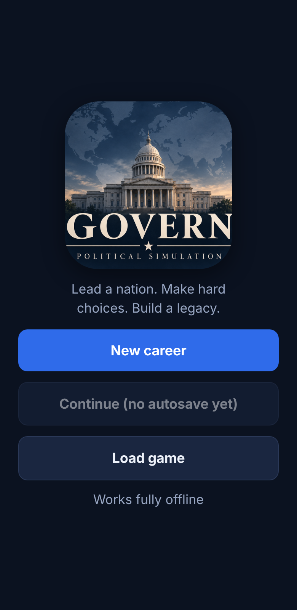
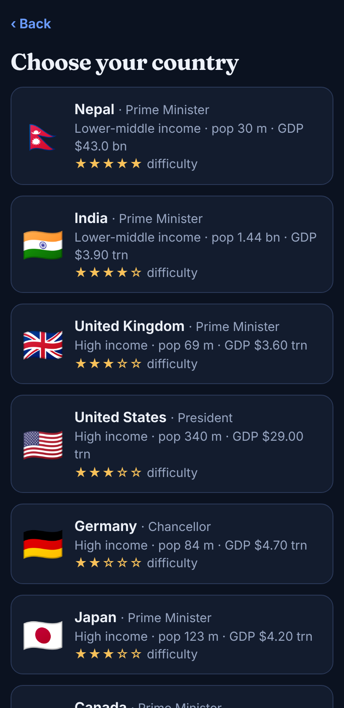
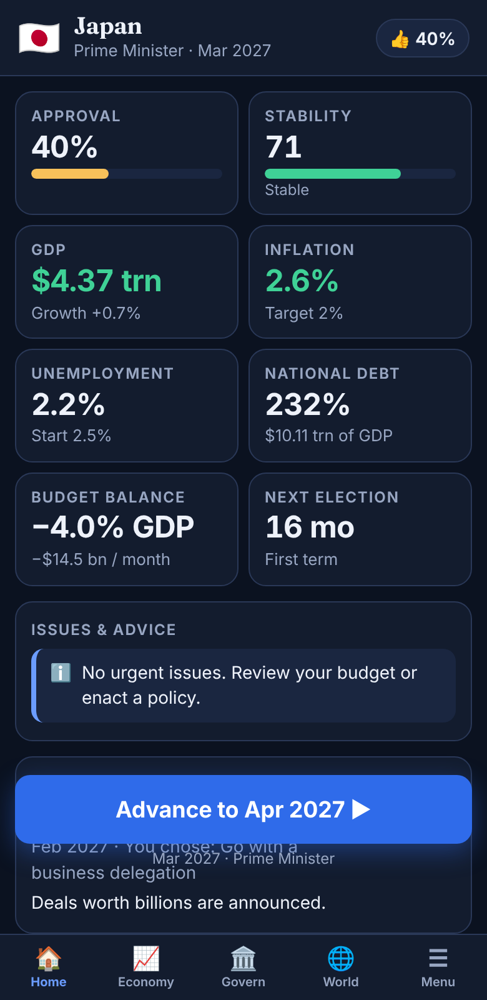
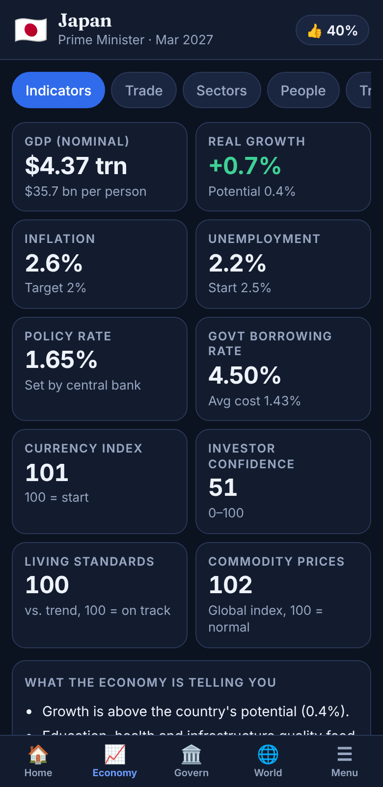
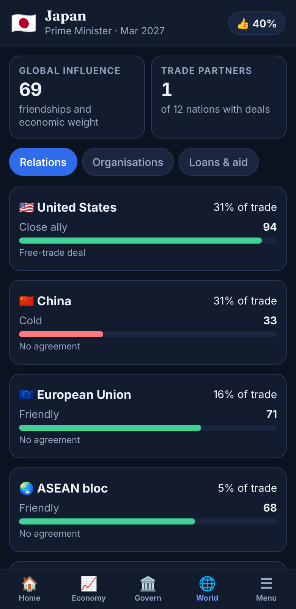
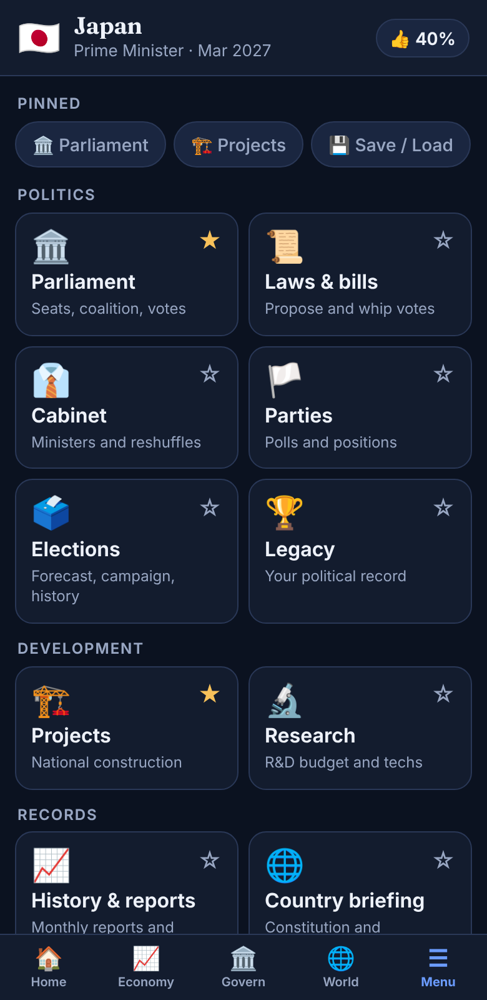
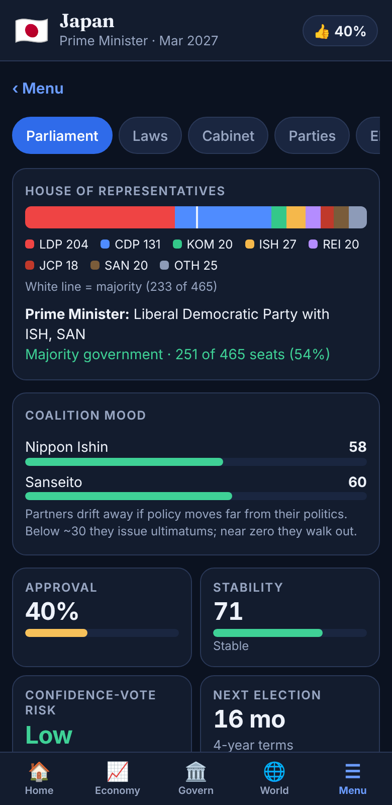
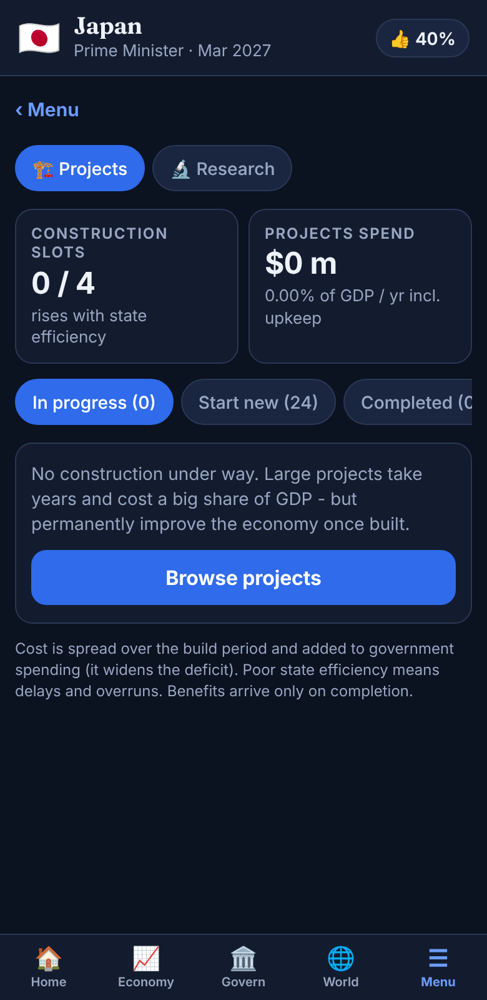

<div align="center">


# GOVERN

**Lead a nation. Make hard choices. Build a legacy.**

A political simulation for Android. Become Prime Minister (or President, or Chancellor), set taxes and budgets, run a parliament, win elections and transform your country over decades. Fully offline, no accounts, no ads.

**[🌐 Website](https://itzunik1.github.io/Govern/)** · [Promotion kit](docs/PROMOTION.md)

[](https://github.com/ItzUnik1/Govern/releases/latest/download/GOVERN.apk)

[](https://github.com/ItzUnik1/Govern/releases/latest)
[](https://github.com/ItzUnik1/Govern/actions/workflows/build-apk.yml)


</div>

---

## Download

| | |
|---|---|
| **Latest APK (always current)** | [`GOVERN.apk`](https://github.com/ItzUnik1/Govern/releases/latest/download/GOVERN.apk) |
| **Copy stored in this repo** | [`download/GOVERN.apk`](download/GOVERN.apk) ([raw link](https://github.com/ItzUnik1/Govern/raw/main/download/GOVERN.apk)) |
| **Older builds** | [Releases](https://github.com/ItzUnik1/Govern/releases) |

### Install on your phone (about a minute)

1. Tap the **Download** button above. Your browser may warn that APK files can be harmful; choose *Download anyway*.
2. Open the downloaded file (check the *Downloads* folder or your browser's download list).
3. Android asks to allow **Install unknown apps** for your browser or file manager. Allow it, then tap **Install**.
4. If Play Protect says the app is unrecognised, choose **Install anyway**. GOVERN is not on the Play Store, so this is expected.
5. Open **GOVERN** and start a new career.

**Updating:** from build 12 on, GOVERN checks for new versions by itself when you are online. A banner appears; tap it, then *Download & install*. You can also use **Menu → Settings → Check for updates**. Otherwise, install the new APK over the old one. Your saves are kept. If Android refuses the update, uninstall first (this erases local saves).

> **About the APK type:** the current files are *debug-signed* builds. They install and play normally, but they are not Play Store releases. A signed release build is planned for the final stage.

---

## Screenshots

<table>
  <tr>
    <td></td>
    <td></td>
    <td></td>
    <td></td>
  </tr>
  <tr>
    <td align="center">Title</td><td align="center">Pick a country</td><td align="center">Home dashboard</td><td align="center">Economy</td>
  </tr>
  <tr>
    <td></td>
    <td></td>
    <td></td>
    <td></td>
  </tr>
  <tr>
    <td align="center">Diplomacy</td><td align="center">Menu hub</td><td align="center">Parliament</td><td align="center">National projects</td>
  </tr>
</table>

---

## What you can do

- **Run the economy:** GDP, inflation, unemployment, debt, interest rates, currency, trade, investment and seven economic sectors, all linked. Tax cuts, spending and borrowing have real consequences.
- **Win and hold power:** parliament, coalitions, confidence votes, bills and whip counts, constituency-level elections, campaigns and manifesto promises. Lose and you lead the opposition.
- **Build your cabinet:** appoint ministers whose competence changes how well policy is delivered.
- **Shape the world:** relations with 13 nations, trade deals, organisations, IMF/World Bank/China loans, aid and sanctions.
- **Develop the nation:** around 40 multi-year national projects (highways, hydropower, hospitals, research parks) plus a 15-technology research tree. Delays and overruns depend on how capable your state is.
- **Survive events:** dozens of context-sensitive crises and opportunities with no obviously correct answer.
- **Play for decades:** one turn is one month, a career can last many terms, and every term feeds your political legacy.
- **Five save slots plus autosave**, all stored on your phone.
- **In-app updates:** the game only goes online to look for a newer version (and never needs to).

### Playable countries

🇳🇵 Nepal · 🇮🇳 India · 🇬🇧 United Kingdom · 🇺🇸 United States · 🇩🇪 Germany · 🇯🇵 Japan · 🇨🇦 Canada · 🇦🇺 Australia

Each has its own constitution, electoral system, real parties, economy, resources and starting problems. More countries are on the way (target: 15–20).

> Party names are real, but their positions, vote shares and all leaders are in-game approximations. The simulation is a game, not a forecast.

---

## Roadmap

| Stage | Focus | Status |
|---|---|---|
| 1 | Core economy, budgets, events, saves, Android APK | ✅ Done |
| 2 | Parliament, elections, coalitions, ministers, opposition | ✅ Done |
| 3 | Diplomacy, trade, loans, projects, research | ✅ Done |
| 4 | More countries, custom difficulty, new events, balancing | 🔜 Next |
| 5 | Living world, scenarios, achievements | Planned |
| 6 | Society, media, MPs and factions, referendums, regions | Planned |
| 7 | Security and multi-step crises | Planned |
| 8 | Advisors, stats screens, tutorial, themes, languages | Planned |
| 9 | Final signed release APK | Planned |

Detailed status, known issues and notes for continuing development are in [`docs/PROGRESS.md`](docs/PROGRESS.md). How the simulation works is described in [`docs/SIMULATION.md`](docs/SIMULATION.md).

---

## For developers

GOVERN is React + TypeScript + Vite, packaged for Android with Capacitor. The simulation engine (`src/engine/`) has no UI code and is tested headlessly.

```
src/engine/   simulation: economy, politics, diplomacy, projects, research, events, saves
src/ui/       mobile screens and the Menu hub
scripts/      headless balance tests, event checks, browser end-to-end test
android/      Capacitor Android project
docs/         SIMULATION.md (formulas), PROGRESS.md (status), screenshots
.github/workflows/build-apk.yml   cloud APK build
download/     newest APK, committed automatically by the build
```

**Building without a computer:** every push to `main` runs the *Build Android APK* workflow on GitHub Actions (free). It type-checks, runs the simulation tests, builds the web bundle and the APK, publishes a release with `GOVERN.apk` and refreshes `download/GOVERN.apk`. To rebuild by hand: **Actions → Build Android APK → Run workflow**.

**With a computer:** `npm install`, then `npm run dev` (browser), `npm run build`, `npm run test:sim`.

If a build fails, open the failed run, copy the red error text and paste it into a new Claude session together with `docs/PROGRESS.md`.
